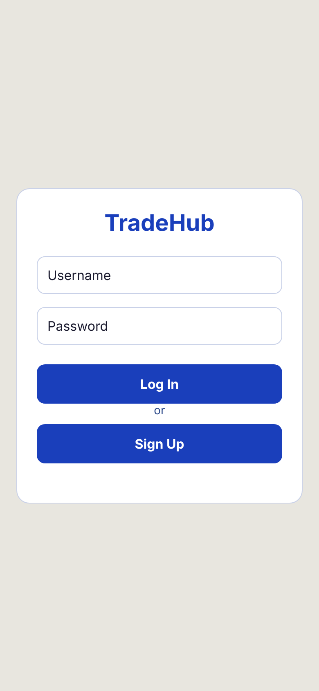
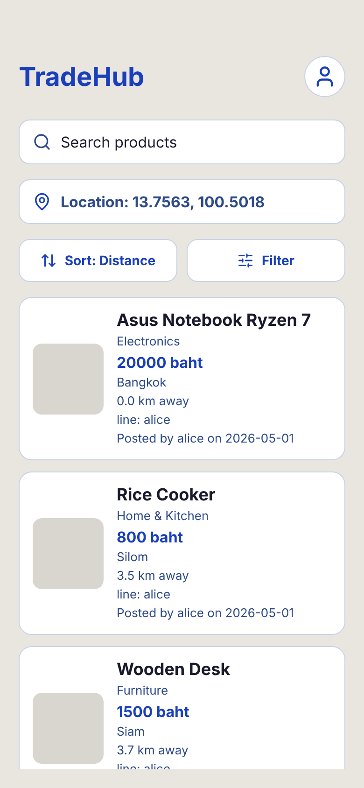
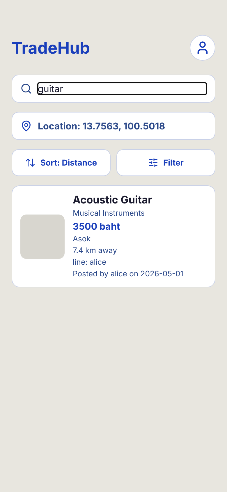
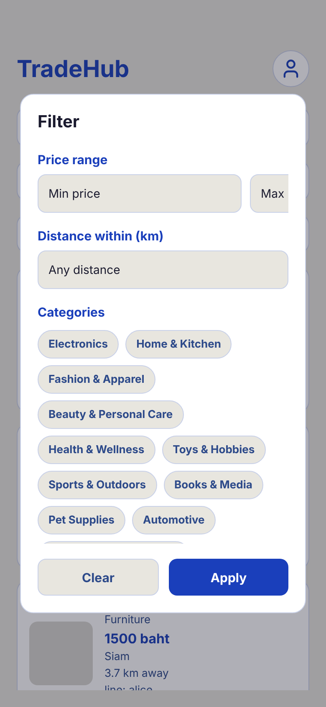
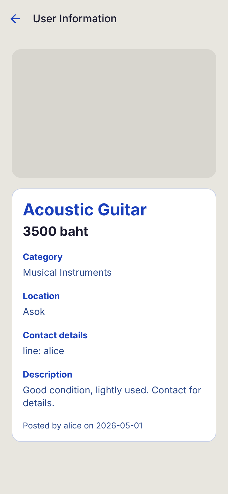
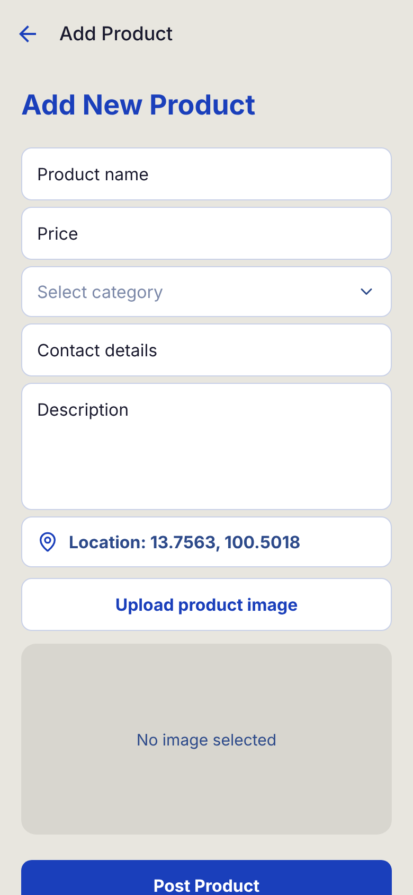
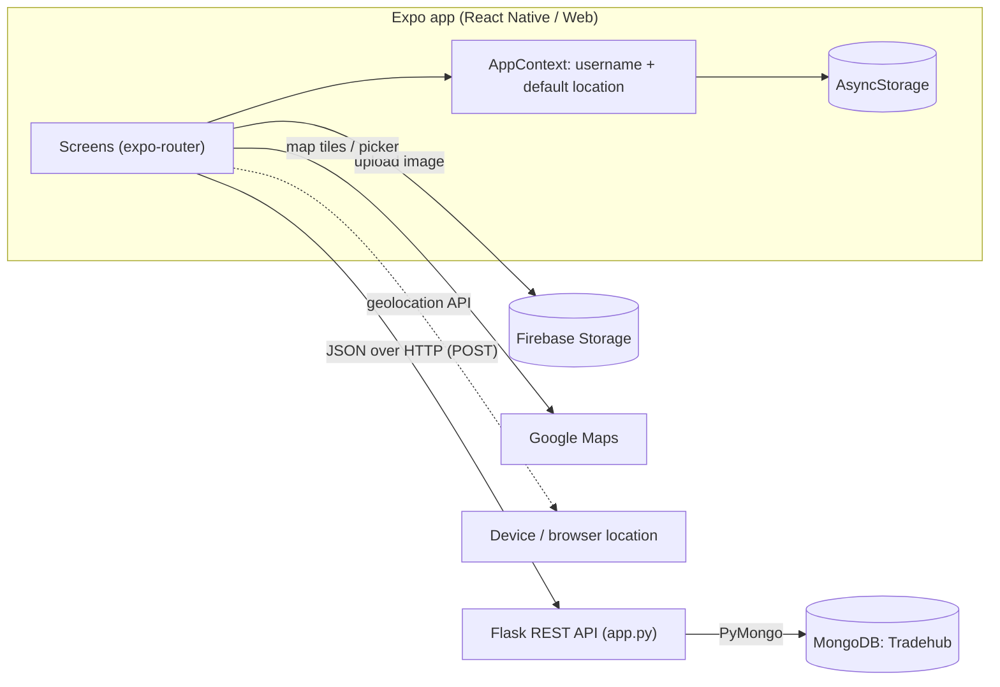
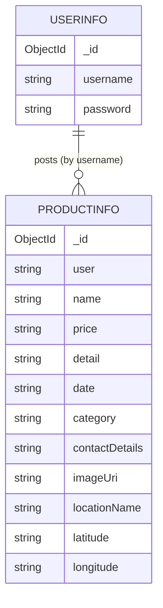

# TradeHub

A location-aware second-hand marketplace for mobile and web. Users sign up, post items for sale with a photo, category, price, contact details and map location, and browse other people's listings sorted by distance, with keyword search and filters.

Course project for **2190512 Application Development**: a demo app built to practise the course tech stack. It has no real users and was never run in production.

## Screenshots

Screenshots were captured from the real Expo web build running against the real Flask backend. The backend used an in-memory MongoDB substitute (`mongomock`) seeded with **demo data** (fake users and items, no photos), 390x844 viewport.

| Login / Sign up | Home (nearby listings) | Search | Filter |
|---|---|---|---|
|  |  |  |  |

| Product details | Profile | Add product |
|---|---|---|
|  |  |  |

## Features

- Sign up and log in with username and password; the logged-in username is remembered on the device (AsyncStorage).
- Home feed of all listings except the user's own, with the distance from the user's location shown in km.
- Current location obtained from the browser geolocation API, or chosen manually on a map screen; saved as the default location.
- Sorting: by distance, price low to high, price high to low.
- Filtering: price range, maximum distance (km), multiple categories (18 predefined categories).
- Keyword search (debounced 300 ms) across name, detail, category, contact details and location name (case-insensitive, server-side regex).
- Add, edit and delete your own listings; the server only modifies a listing if the `user` field matches.
- Product photo picked from the device library and uploaded to Firebase Storage; the download URL is stored in the listing.
- Location picker map: Google Maps JavaScript API on web, `react-native-maps` on native (platform-specific components).
- Client-side form validation (required fields, positive numeric price, location required).

## Tech stack

| Layer | Technology |
|---|---|
| Frontend | Expo SDK 54, React Native 0.81, React 19.1, TypeScript 5.9, expo-router 6 (file-based routing, typed routes), React Compiler enabled, react-native-web |
| UI libraries | lucide-react-native icons, expo-image, @react-navigation/native theme, custom palette in `constants/theme.ts` |
| Device/native | expo-image-picker, react-native-maps, AsyncStorage, react-native-reanimated, gesture-handler |
| Backend | Python, Flask, Flask-CORS, PyMongo, python-dotenv |
| Database | MongoDB (database `Tradehub`, 2 collections), expected via a MongoDB Atlas URI |
| Cloud storage | Firebase Storage (image upload, `firebase` JS SDK 12) |
| Maps | Google Maps JavaScript API (web), Google Maps via react-native-maps (native) |

## Architecture



## How it works

1. **Auth**: the client POSTs `{username, password}` to `/login` or `/signUp`. On success the client stores the username in React context and AsyncStorage and navigates to `/home`. There are no tokens or sessions; the username is sent in later request bodies (`user`, `username`) to identify the owner.
2. **Browsing**: `home.tsx` calls `POST /getAllProducts` with an optional keyword (debounced 300 ms). Distance (haversine formula, Earth radius 6371 km), price filtering, category filtering, exclusion of own listings and sorting are all done on the client. Listings without valid coordinates get infinite distance.
3. **Posting**: `addNewProduct.tsx` validates the form, uploads the picked image to Firebase Storage (resumable upload, 30 s timeout, path `products/<username>/<timestamp>.jpg`), then calls `POST /addProduct` (or `/updateProduct` when editing). The server validates the category against a fixed set.
4. **Ownership**: update and delete queries match on both `_id` and `user`, so a user cannot change someone else's listing via these endpoints (see Known limitations regarding authentication).
5. **Location**: the home screen requests browser geolocation once; if unavailable or denied, it prompts the user to choose a location on the map screen. The result is passed back via route params and persisted.

### API endpoints (Flask, port 5000)

All endpoints except `/` are `POST` with a JSON body.

| Endpoint | Purpose | Key responses |
|---|---|---|
| `GET /` | Health check (returns "hello") | 200 |
| `POST /login` | Check username/password | 200, 404 user not found, 401 wrong password |
| `POST /signUp` | Create user if username free | 200, 401 username taken |
| `POST /getUserInfo` | Return `_id` and username for a user | 200, 404 |
| `POST /getUserProducts` | Listings of one user | 200 |
| `POST /getAllProducts` | All listings, optional keyword search | 200 |
| `POST /addProduct` | Create listing (category validated) | 200, 400 invalid category |
| `POST /updateProduct` | Update own listing | 200, 400, 404 |
| `POST /deleteProduct` | Delete own listing | 200, 404 |

### Data model (MongoDB, no enforced schema; shape inferred from `app.py` and `components/interface.ts`)



The relationship is by convention only (`productInfo.user` holds the username); MongoDB does not enforce it. Price and coordinates are stored as strings.

### Screens

| Route | File | Purpose |
|---|---|---|
| `/` | `app/index.tsx` | Entry, redirects to login |
| `/login` | `app/login.tsx` | Log in / sign up |
| `/home` | `app/home.tsx` | Listing feed, search, sort, filter, location |
| `/productDetails` | `app/productDetails.tsx` | Listing details (modal) |
| `/userInfo` | `app/userInfo.tsx` | Profile, own listings, delete, logout (modal) |
| `/addNewProduct` | `app/addNewProduct.tsx` | Add / edit listing (modal) |
| `/mapScreen` | `app/mapScreen.tsx` | Pick location on a map (modal) |

## Results / outputs

- The Expo web build (`npx expo export --platform web`) compiled successfully and was run end to end against the Flask API with seeded demo data: login, feed with distances (e.g. 0.0 km, 3.5 km, 3.7 km for demo items), keyword search, filter sheet, product details, profile, add form. See screenshots above.
- Not exercised in the screenshots: Firebase image upload and Google Maps (they require real keys), and native iOS/Android builds.
- No automated tests exist in the repository.

## How to run

Prerequisites: Node.js, Python 3, a MongoDB instance (e.g. Atlas), optionally Firebase project and Google Maps API key.

```bash
git clone https://github.com/kookithub/2190512_Application_Development_TradeHub.git
cd 2190512_Application_Development_TradeHub

# 1. Configure secrets (never commit .env)
cp .env.example .env     # fill MONGODB_URI, GOOGLE_MAPS_API_KEY, EXPO_PUBLIC_FIREBASE_* values

# 2. Backend
pip install flask flask-cors pymongo python-dotenv
python app.py            # http://127.0.0.1:5000

# 3. Frontend (second terminal)
npm install
npm install react-native-svg   # required by lucide-react-native but not listed in package.json
npm run web              # or: npm run android / npm run ios
```

The API base URL is hard-coded in `components/api.ts` (`http://127.0.0.1:5000`, or `http://10.0.2.2:5000` on the Android emulator). A physical phone needs this changed to the computer's LAN address.

## Repository structure

```
app.py                 Flask backend (9 routes, 2 MongoDB collections)
app/                   expo-router screens + root layout/context
components/            API URL, Firebase config, TS interfaces, map components (.native/.web), themed text
constants/             categories list, theme/palette
hooks/                 color-scheme hooks
assets/images/         app icons and splash
app.json, app.config.js  Expo config; app.config.js injects the Maps key from env
.env.example           Placeholder environment variables
docs/images/           README screenshots
```

## Known limitations (verified in code)

- Passwords are stored and compared in plain text (`app.py` imports `check_password_hash` but does not use it); there are no tokens, so the API trusts the username in the request body.
- Prices, dates and coordinates are stored as strings; filtering and sorting happen on the client over the full listing set (no pagination).
- `react-native-svg` (needed by `lucide-react-native`) is not declared in `package.json`.
- `app.run(debug=True, host="0.0.0.0")` is hard-coded.

## Project Facts (for resume)

Plain facts only; verified from the code.

- **Course**: 2190512 Application Development.
- **Purpose**: course demo app to practise the tech stack; no production users.
- **Languages / frameworks / libraries**: TypeScript/TSX, Python; Expo 54, React Native 0.81, React 19.1, expo-router 6, react-native-web, react-native-maps, lucide-react-native, expo-image, expo-image-picker, AsyncStorage, Firebase JS SDK 12 (Storage only), date-fns, Flask, Flask-CORS, PyMongo, python-dotenv, MongoDB, Google Maps API.
- **Size**: about 2,850 lines TypeScript/TSX (app, components, constants, hooks) plus 240 lines Python (`app.py`); about 3,100 lines total; 6 screens plus 1 entry redirect; 8 API endpoints plus 1 health route; 2 MongoDB collections; 18 product categories; 41 tracked files.
- **Key features**: see Features above (geo-distance sorting, filters, search, image upload, map picker, CRUD on own listings, cross-platform web/iOS/Android code).
- **Auth method**: username/password check against MongoDB via `/login` and `/signUp`; passwords stored in plain text; no token/session; username persisted client-side in AsyncStorage.
- **Algorithms / design patterns**: haversine great-circle distance (client); debounced search; React Context for global state; platform-specific module resolution (`.native.tsx` / `.web.tsx`) for the map; REST-style JSON API; server-side category whitelist; ownership check by matching `_id` + `user` on update/delete; escaped, case-insensitive regex search (`re.escape`).
- **Measurable numbers**: only the size counts above are verified. Users: none (no real users).
- **Hard problems and how solved (evidence in code)**: web vs native map support solved with separate `LocationMap` implementations (Google Maps JS API loaded dynamically on web); image upload from a local URI solved by converting to a Blob via XHR and using Firebase resumable upload with a 30 s timeout; secrets removed from source via `.env`, `app.config.js` and `EXPO_PUBLIC_*` variables.
- **Outcome**: working prototype verified by running the web build against the backend (screenshots). Working demo app (no production users).
