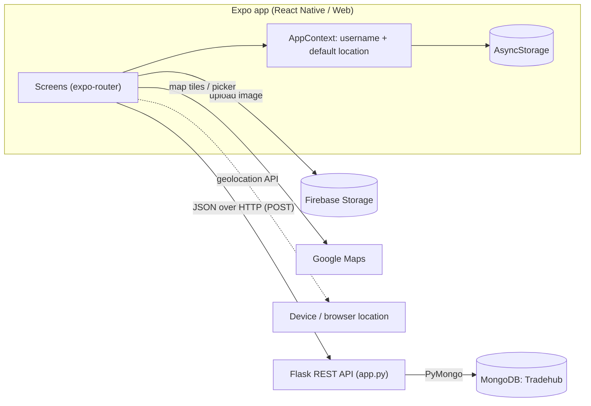
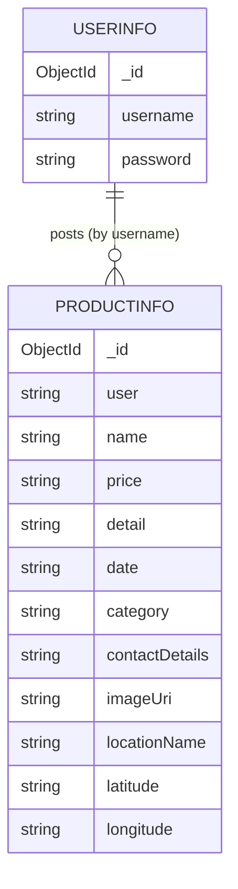

# TradeHub

A second-hand marketplace app for mobile and web that knows where you are. You sign up, post things you want to sell (with a photo, category, price, contact details and a spot on the map), and browse what other people are selling, sorted by how far away it is. There's keyword search and filters too.

This was a team course project for **2190512 Application Development**, built to practise the course tech stack. We worked on all parts of it together. It's a demo, so there are no real users and it never ran in production.

## Screenshots

These come from the Expo web build running against the Flask backend. For the screenshots the backend used `mongomock` (an in-memory MongoDB stand-in) filled with **demo data**: fake users and items, no photos. Viewport is 390x844.

| Login / Sign up | Home (nearby listings) | Search | Filter |
|---|---|---|---|
|  |  |  |  |

| Product details | Profile | Add product |
|---|---|---|
|  |  |  |

## Features

- Sign up and log in with a username and password. The app remembers who's logged in on the device (AsyncStorage).
- A home feed with everyone's listings except your own, showing how many km away each one is.
- Your location comes from the browser's geolocation, or you can pick it yourself on a map. It's saved as your default.
- Sort by distance, or by price (low to high, high to low).
- Filter by price range, max distance (km) and one or more of 18 categories.
- Keyword search (debounced by 300 ms) over the name, details, category, contact details and location name. It's case-insensitive and runs on the server.
- Add, edit and delete your own listings. The server only changes a listing if it belongs to you.
- Pick a photo from your device and it gets uploaded to Firebase Storage. The listing keeps the download URL.
- Location picker map: Google Maps JavaScript API on web, `react-native-maps` on native.
- Form checks before submitting (required fields, price has to be a positive number, location is required).

## Tech stack

| Layer | Technology |
|---|---|
| Frontend | Expo SDK 54, React Native 0.81, React 19.1, TypeScript 5.9, expo-router 6 (file-based routing, typed routes), React Compiler, react-native-web |
| UI | lucide-react-native icons, expo-image, @react-navigation/native theme, custom palette in `constants/theme.ts` |
| Device / native | expo-image-picker, react-native-maps, AsyncStorage, react-native-reanimated, gesture-handler |
| Backend | Python, Flask, Flask-CORS, PyMongo, python-dotenv |
| Database | MongoDB (database `Tradehub`, 2 collections), connected through a MongoDB Atlas URI |
| File storage | Firebase Storage for images (`firebase` JS SDK 12) |
| Maps | Google Maps JavaScript API (web), Google Maps through react-native-maps (native) |

## Architecture



## How it works

1. **Logging in.** The app sends `{username, password}` to `/login` or `/signUp`. If it works, the username is kept in React context and AsyncStorage and you land on `/home`. There are no tokens or sessions. Later requests just include the username (`user`, `username`) so the server knows who you are.
2. **Browsing.** `home.tsx` calls `POST /getAllProducts`, with a keyword if you typed one. Everything else happens on the phone: distance (haversine formula, Earth radius 6371 km), price and category filters, hiding your own listings, and sorting. Listings without proper coordinates get pushed to the end with infinite distance.
3. **Posting.** `addNewProduct.tsx` checks the form, uploads the photo to Firebase Storage (resumable upload, 30 s timeout, saved under `products/<username>/<timestamp>.jpg`), and then calls `POST /addProduct`, or `/updateProduct` if you're editing. The server checks the category against a fixed list.
4. **Ownership.** Update and delete only match a listing when both `_id` and `user` line up, so you can't change someone else's listing through these endpoints. (See the limitations below about how weak the auth is, though.)
5. **Location.** The home screen asks for browser geolocation once. If that fails or you say no, it asks you to pick a spot on the map. The result comes back through route params and gets saved.

### API endpoints (Flask, port 5000)

Everything except `/` is a `POST` with a JSON body.

| Endpoint | What it does | Responses |
|---|---|---|
| `GET /` | Health check (returns "hello") | 200 |
| `POST /login` | Check username and password | 200, 404 user not found, 401 wrong password |
| `POST /signUp` | Create a user if the name is free | 200, 401 username taken |
| `POST /getUserInfo` | Return `_id` and username for a user | 200, 404 |
| `POST /getUserProducts` | One user's listings | 200 |
| `POST /getAllProducts` | All listings, optional keyword search | 200 |
| `POST /addProduct` | Create a listing (category checked) | 200, 400 invalid category |
| `POST /updateProduct` | Update your own listing | 200, 400, 404 |
| `POST /deleteProduct` | Delete your own listing | 200, 404 |

### Data model

MongoDB doesn't enforce a schema here. This is the shape the code in `app.py` and `components/interface.ts` uses:



The link between the two is just a convention: `productInfo.user` holds the username. Price and coordinates are stored as strings.

### Screens

| Route | File | What it's for |
|---|---|---|
| `/` | `app/index.tsx` | Entry point, sends you to login |
| `/login` | `app/login.tsx` | Log in / sign up |
| `/home` | `app/home.tsx` | Listing feed, search, sort, filter, location |
| `/productDetails` | `app/productDetails.tsx` | Listing details (modal) |
| `/userInfo` | `app/userInfo.tsx` | Profile, your listings, delete, logout (modal) |
| `/addNewProduct` | `app/addNewProduct.tsx` | Add or edit a listing (modal) |
| `/mapScreen` | `app/mapScreen.tsx` | Pick a location on the map (modal) |

## Current state

- The Expo web build (`npx expo export --platform web`) builds fine and works end to end against the Flask API with demo data: login, the feed with distances (for example 0.0 km, 3.5 km, 3.7 km), search, filters, product details, profile and the add form. That's what the screenshots show.
- Firebase image upload and Google Maps need real keys, so they aren't in the screenshots. Native iOS/Android builds weren't tried for them either.
- There are no automated tests yet.

## How to run

You'll need Node.js, Python 3 and a MongoDB instance (Atlas works). A Firebase project and a Google Maps API key are optional.

```bash
git clone https://github.com/kookithub/2190512_Application_Development_TradeHub.git
cd 2190512_Application_Development_TradeHub

# 1. Set up your keys (don't commit .env)
cp .env.example .env     # fill in MONGODB_URI, GOOGLE_MAPS_API_KEY, EXPO_PUBLIC_FIREBASE_* values

# 2. Backend
pip install flask flask-cors pymongo python-dotenv
python app.py            # http://127.0.0.1:5000

# 3. Frontend (in a second terminal)
npm install
npm install react-native-svg   # lucide-react-native needs it, but it's missing from package.json
npm run web              # or: npm run android / npm run ios
```

The API address is hard-coded in `components/api.ts` (`http://127.0.0.1:5000`, or `http://10.0.2.2:5000` on the Android emulator). If you run it on a real phone, change it to your computer's LAN address.

## Repository structure

```
app.py                 Flask backend (9 routes, 2 MongoDB collections)
app/                   expo-router screens + root layout/context
components/            API URL, Firebase config, TS interfaces, map components (.native/.web), themed text
constants/             category list, theme/palette
hooks/                 color-scheme hooks
assets/images/         app icons and splash
app.json, app.config.js  Expo config; app.config.js pulls the Maps key from env
.env.example           placeholder environment variables
docs/images/           README screenshots
```

## Known limitations

- Passwords are stored and compared as plain text (`app.py` imports `check_password_hash` but never uses it). There are no tokens either, so the API just trusts whatever username comes in the request.
- Prices, dates and coordinates are strings, and filtering and sorting happen on the phone over the whole list (no pagination).
- `react-native-svg` is needed by `lucide-react-native` but isn't in `package.json`.
- `app.run(debug=True, host="0.0.0.0")` is hard-coded.
